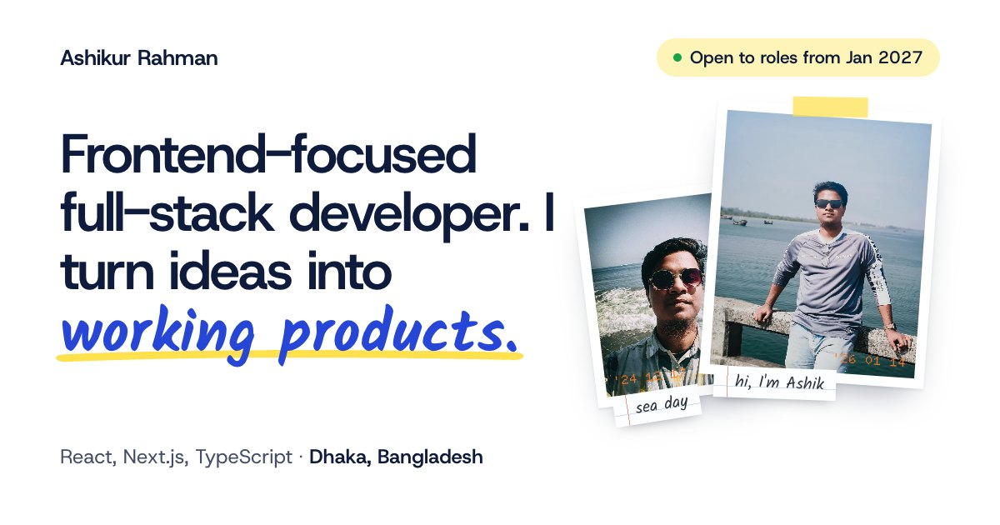

# Ashikur Rahman · Portfolio

My personal site: a notebook page with a playful desk you can actually use.

**Live:** [ashikur-on-web.vercel.app](https://ashikur-on-web.vercel.app)



## What's on the page

- **Hero:** a pen writes "working products." and a yellow marker underlines it.
- **My desk:** type on the keyboard and the laptop shows it; press play on the phone for a few nasheeds; flip through the photo pile; click the pen. Everything works with a mouse, touch or the keyboard.
- **Work:** stacking project cards with real screenshots in a browser frame.
- **Experience:** one notebook row per job, with a photo from that team on hover (inline on phones).
- **Notes:** my latest posts, read from my Hashnode blog's RSS feed at build time, refreshed every hour.
- **Bottom menu:** a sticky-note buddy that follows the section you're on and reacts when you poke it.

## Built with

- [Next.js 14](https://nextjs.org) (App Router, static pages), React 18 and TypeScript
- Plain CSS Modules, no CSS framework
- CSS scroll-driven animations, with fallbacks and full `prefers-reduced-motion` support
- Web Audio for the desk sounds and the rain track, made in the browser with no files
- [Lenis](https://lenis.darkroom.engineering) for smooth scrolling
- Fonts: Host Grotesk, Kalam and Doto

## Speed

Lab numbers from a clean production build (3 cold loads each, mid-range phone with 4x slower CPU on slow 4G):

| | Phone | Desktop |
|---|---|---|
| Largest Contentful Paint | 1.3 s | 0.2 s |
| Cumulative Layout Shift | 0 | 0 |
| Interaction to Next Paint | 80 ms | 72 ms |
| Total Blocking Time | 0 ms | 0 ms |

Music only downloads when someone presses play, then the browser keeps it.

## Run it locally

Needs Node.js 24 and Yarn.

```bash
yarn install
yarn dev            # http://localhost:3000
```

| Command | What it does |
|---|---|
| `yarn build` | Production build, then writes the sitemap and robots.txt |
| `yarn test` | Unit tests (Node's built-in test runner) |
| `yarn smoke` | Browser checks against a running build (uses your installed Chrome) |
| `yarn check:launch` | Fails if any placeholder content is left on the page |

## Where things live

```
app/            page, layout, SEO tags, share image, icons, fonts
components/
  site/         shared pieces: buttons, headings, bottom menu, marker, pen writing
  sections/     Hero, Projects, Experience, Notes, Closing
  desk/         the desk: keyboard, laptop, phone player, photos, books, pen
data/index.ts   all the text, projects, jobs, photos and tracks in one file
lib/            sound engine, RSS reader, keyboard layouts (each with unit tests)
public/         photos, project screenshots, logos, audio, resume
scripts/        browser smoke tests
```

To change any text, project or photo, edit `data/index.ts`.

## Note

The photos, resume and personal details are mine. Please don't reuse them. You're welcome to read the code and borrow ideas.
